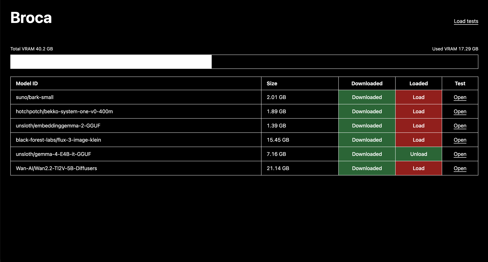

# Broca

Broca is a local AI inference server and Python library for NVIDIA and AMD GPUs
on Linux and Apple Silicon on macOS. It manages model downloads and serves text,
embeddings, decisions, speech, images, and video from your own machine.

All inference requests are asynchronous and go through a batch scheduler.
Text and embedding pipelines can process multiple requests in one backend
batch. The same async API can run on independent inference workers in a
distributed deployment.

Use Broca when you want to prototype against a local API or keep inference
inputs on hardware you control. GPU acceleration depends on the model and
installed runtime. Use CUDA for NVIDIA, ROCm for supported AMD GPUs, and
Metal or MPS for Apple Silicon.
[llama.cpp accelerator builds](https://github.com/ggml-org/llama.cpp/blob/master/docs/build.md),
[PyTorch ROCm](https://docs.pytorch.org/docs/stable/notes/hip.html),
[PyTorch MPS](https://docs.pytorch.org/docs/stable/notes/mps.html).

## Usage

Use Python 3.11 or newer. From a checkout, run `uv sync --locked` to install
Broca with its inference backends.

### Define a custom AI model

Create an `AiModel` with a Hugging Face repository ID in `lab/model` form.
Choose assets that match the pipeline's backend. For example, save this
text-only EmbeddingGemma configuration as `model.py`.

```python
from broca import AiModel

model = AiModel(
    id="unsloth/embeddinggemma-2-GGUF",
    type="embedding",
    file="embeddinggemma-2-Q8_0.gguf",
    context_window=2048,
)
```

Set `clip` for a compatible multimodal projector or `weights_repo` if the
checkpoint lives in a separate repository. Use `revision` and `weights_revision`
to pin those repositories independently. `AiModel.model_json_schema()` describes
every field. Broca stores assets under `~/ai/{lab}/{model}` and reads gated model
credentials from the Hugging Face credential store or `HF_TOKEN`.

### Run an inference pipeline

Pass your configuration to the matching pipeline class. Download the selected
assets, load the backend, await inference, then unload the backend when done.
Save this example alongside `model.py` and run it with `uv run python infer.py`.

```python
import asyncio

from broca.inference.embedding import EmbeddingPipeline

from model import model

pipeline = EmbeddingPipeline(model=model)
asyncio.run(pipeline.model.download())
pipeline.load()
try:
    result = asyncio.run(pipeline.infer(["A short example"]))
    print(result.vectors[0][:5])
finally:
    pipeline.unload()
```

Each pipeline class uses its built-in model when constructed without arguments.
Each modality package also exports a shared default instance as `pipeline`.

| Import from | Pipeline class | Default model | Backend |
| --- | --- | --- | --- |
| `broca.inference.audio` | `AudioPipeline` | Bark Small (`suno/bark-small`) | Transformers |
| `broca.inference.decision` | `DecisionPipeline` | Bekko System One v0 400M (`hotchpotch/bekko-system-one-v0-400m`) | Sentence Transformers |
| `broca.inference.embedding` | `EmbeddingPipeline` | EmbeddingGemma 2 (`unsloth/embeddinggemma-2-GGUF`) | llama.cpp |
| `broca.inference.images` | `ImagePipeline` | FLUX 3 Image Klein (`black-forest-labs/flux-3-image-klein`) | Diffusers |
| `broca.inference.text` | `TextPipeline` | Gemma 4 E4B IT (`unsloth/gemma-4-E4B-it-GGUF`) | llama.cpp |
| `broca.inference.video` | `VideoPipeline` | Wan 2.2 TI2V 5B (`Wan-AI/Wan2.2-TI2V-5B-Diffusers`) | Diffusers |

The image and video defaults load quantized transformer weights from
`unsloth/flux-3-image-klein-GGUF` and `unsloth/Wan2.2-TI2V-5B-GGUF`,
respectively.

### Run the inference server with FastAPI

Mount Broca's exported router in a FastAPI app. Save this as `app.py`.

```python
from fastapi import FastAPI

from broca import broca_router

app = FastAPI()
app.include_router(broca_router)
```

```bash
uv run --locked uvicorn app:app --host 127.0.0.1 --port 9001
```

The router mounts the inference API under `/v1` and FastAPI serves interactive
API docs at `http://localhost:9001/docs`.

### Run the published package or container

Install a published version with `pip install broca`, then start the server with
`python -m broca`.

The Docker image runs on Linux x86-64. This command persists downloaded models
in the `broca-models` volume and exposes the server on localhost.

```bash
docker run --rm --publish 127.0.0.1:9001:9001 \
  --mount source=broca-models,target=/home/broca/ai \
  lange-labs/mesh:latest
```

For CUDA, install the NVIDIA Container Toolkit and a driver compatible with
CUDA 13.2 on the host, then add `--gpus all` to the command. You can check both
inference backends on the host without downloading a model.

```bash
docker run --rm --gpus all --entrypoint python lange-labs/mesh:latest \
  -c 'import llama_cpp, torch; assert torch.cuda.is_available(); assert llama_cpp.llama_supports_gpu_offload()'
```

## Dashboard

Open the dashboard at `http://localhost:9001/` to download, load, and test models
from the built-in catalog.



## Development

```bash
uv run ruff check .
uv run --locked pytest -q
node --test tests/*.mjs
uv build
```

The benchmarks use an OpenAI-compatible server on `http://127.0.0.1:8080/v1`.
With a compatible server running, use
`uv run --group benchmarks python tests/benchmarks/gemma_4_llama_cpp.py` or
`uv run --group benchmarks python tests/benchmarks/gemma_4_mlx_vlm.py`.
